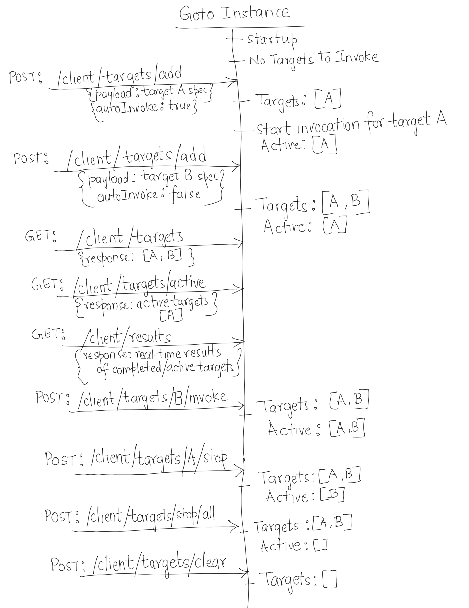

# Goto Client: Targets and Traffic Invocation
Flow showing usage of APIs to configure and invoke traffic from `goto` client instances: add one or more targets (`POST /client/targets/add`), optionally set client options such as tracking headers and results collection, invoke some or all of the targets (`POST /client/targets/{targets}/invoke`, or `/client/targets/invoke/all`), and read the results (`GET /client/results`). When the instance is a peer of a registry, the same operations can be driven for all the peer's instances via the registry (see [Registry Peers Interactions](goto-registry-peers-interactions.md)), and the results are reported to the registry's lockers.

 

 
 

See [Client APIs](../pkg/client/README.md#client-apis) for more details.