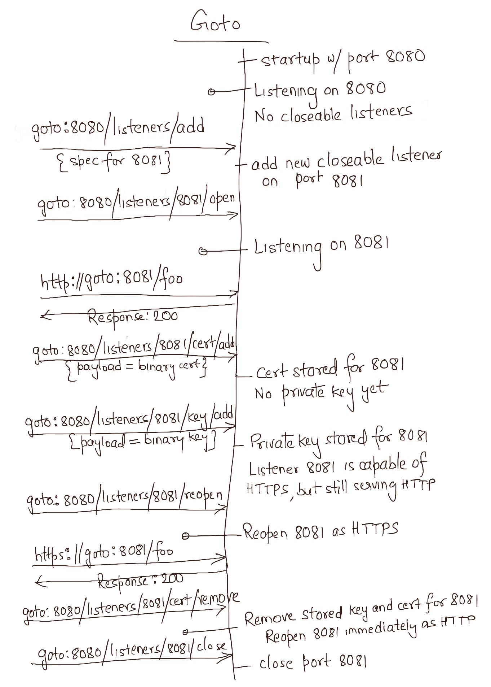

# Goto Server Listeners

A `goto` instance starts with one HTTP listener on the port given as startup argument (`--port`, or the first port of `--ports`; default 8080), plus a JSON-RPC listener (`--rpcPort`, default 3000) and a gRPC listener (`--grpcPort`, default 1234). Additional listeners can be added, opened, closed and configured on-the-fly via the `/server/listeners` APIs, or declared in a startup config file (see the `--config` argument). The flow below shows one such example.

 

 
 

See [Server Listeners](../pkg/server/README.md#listeners) for the listener APIs and the [Listener JSON Schema](../pkg/server/README.md#listener-json-schema), and [Listeners Example](listeners-example.md) for API calls and sample output.