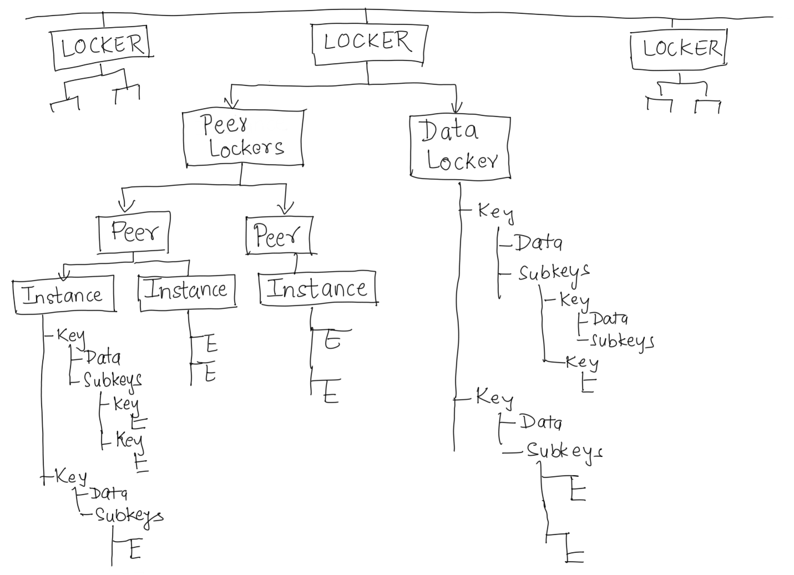
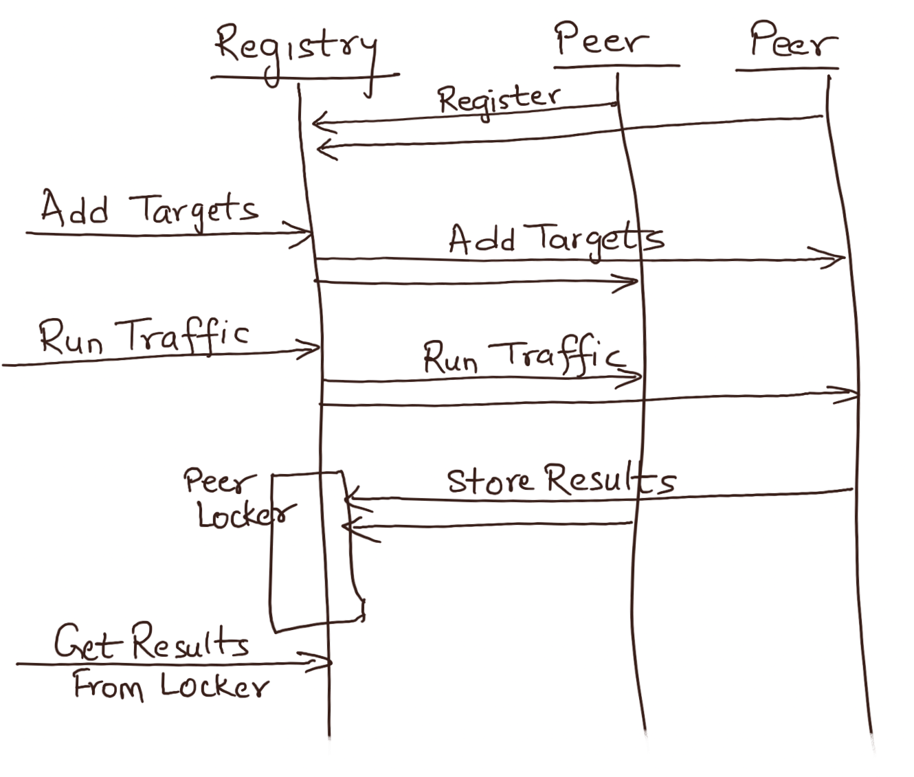

# Goto Lockers

`Goto` provides `Labeled lockers` as general purpose in-memory key-value store. A locker can be created using `/open` API, emptied using `/clear` and removed using `/close`. Labels can be comma-separated (`A,B`) to open a locker `B` nested inside locker `A`; `A,B` is then used as the label to refer to that nested locker, and closing or clearing `A` also removes `B`. Each instance starts with a default locker (label `default`). At any point, one locker remains current (can be referenced in various locker APIs using label `current`). Opening a new locker makes it the current locker. Closing a locker removes it from the memory. If the current locker is removed, the `default` locker becomes current again. Calling `/open` for an existing locker makes it the current locker again. All lockers are accessible using their `labels` until they are closed.

A locker consists of two parts: 
- `Peer Lockers`: used to store results reported by various peer `goto` instances
- `Data Locker`: available for custom data storage/retrieval using `/store`, `/add`, `/remove`, `/get` and `/search` APIs.

 
 

## Data Lockers
A `Data Locker` is a recursive key-value storage structure. Each key may hold some `data` as text, and/or hold a set of `subkeys`. Each subkey in turn holds a `Data Locker` structure of its own, capable of holding data as well as subkeys, and the structure keeps recursing. The recursive tree is built on the fly based on the key paths added via the `/store` APIs.

The `/store` and `/get` APIs hide the complexity of the recursive storage by providing a simple interface that takes all the component keys of a path as comma-separated list, and creates/reads data at/from the given path. E.g. `/lockers/current/store/A,B,C` stores the given payload (POST) in the data field at the leaf (i.e. at node `C`) key path `A -> B -> C`. 

Similarly, `/lockers/X/get/A,B,C` reads data stored under subkey `C` under path `A -> B -> C` in locker `X`. 

If no data was stored under the given path, the `/get` API returns the sub-locker tree at that node (as JSON). Thus, the same API can be used to read a specific key's data as text or an entire sub-tree of a key. 

E.g. given the following store calls were executed: 
- `curl http://goto:8080/registry/lockers/X/store/A,B --data 'B data'`
- `curl http://goto:8080/registry/lockers/X/store/A,C --data 'C data'`

resulting in data being stored under keys `B` and `C` under common parent key `A`.

Then, a call to `curl http://goto:8080/registry/lockers/X/get/A` will return A's subtree (as JSON), which includes subkeys `B` and `C` and their corresponding sublockers. Whereas, a call to `curl http://goto:8080/registry/lockers/X/get/A,B` will return the text `B data` stored under key `B` under parent `A`.

Thus just a small set of APIs can be used in several flexible ways, making the lockers a useful data store for testing purposes (store results, logs, etc.).

 

## Peer Lockers

`Peer Lockers` store data organized by peer labels (as reported by the peer instances). For each peer label, a sublocker is created for each instance of the peer that connects to the registry. Each instance sublocker holds a recursive data structure similar to `Data Locker` . 

When the peers invoke some traffic and collect results, they send their invocations results to the registry in real-time, and registry stores each instance's results in the instance's corresponding instance locker.

Invocation results reported by various peer clients can be viewed in processed form (summary, detailed, and per instance) using the `/client/results` APIs instead (e.g. `/registry/peers/client/results`, `/registry/peers/client/results/details` and `/registry/peers/instances/client/results`, or the same under `/registry/lockers/{label}/peers/...` to read a specific locker). The older `/registry/peers/targets/results` and `/registry/peers/targets/results?detailed=y` forms are still available. Raw data from peer lockers can be viewed using the `/registry/lockers/{label}/peers/{peer}/get/{path}` and `/registry/peers/{peer}/{address}/locker/get/{path}` APIs, or in bulk using `/registry/lockers/{label}?data=y&peers=y` and the `/registry/dump` API. Peer labels are lower-cased in the peer lockers, e.g. a peer registered as `peerA` is found as `peera`.

 

## Behaviour notes

- **Text data**: the payload of `/store` is kept as text, exactly as sent, and `/get` returns it as text. `/add` appends the payload to a list of values at the key path (a value that was stored earlier becomes the first item); `/get` prints such a list as `[a b]`, while the locker views (`/registry/lockers/{label}?data=y`) show it as a JSON list.
- **Missing data**: reading a key path (or a locker) that doesn't exist responds `200` with `{}`; `GET /registry/lockers/{label}` for an unknown label responds `404 Locker not found`.
- **Remove**: `/remove` deletes the key at the end of the path only if it has no sub-keys, and then also deletes the parent keys that are left without sub-keys (together with any data they held).
- **Views**: the locker views hide stored values (`"..."`) and peer lockers unless `data=y` and `peers=y` are given, and trim the tree to `level` levels (`"...": ""` marks trimmed keys). The query parameters are honored only when all of the parameters shown for the API are given together.
- **Search**: `/registry/lockers/search/{text}` and `/registry/lockers/{label}/search/{text}` match `text` (a case-insensitive regular expression) against the keys of the data lockers and return the URIs that read the matching keys.
- **Clearing**: `POST /registry/lockers/clear` (and `close`) without a label resets the registry to a single empty `default` locker, and also asks the peers to clear their client results.
- **Context lockers**: `/registry/context/{context}/lockers/...` provides a separate set of lockers per context (with their own `default` and current locker). They support open/close/clear/store/add/get but don't receive peer results, and are not part of the registry dump.
- **Persistence**: lockers live in memory. `/registry/dump` and `/registry/load` (or `/registry/cloneFrom`) carry the labeled lockers across registry restarts or to another registry.

See [Registry Locker APIs](../pkg/registry/README.md#locker-management-apis)