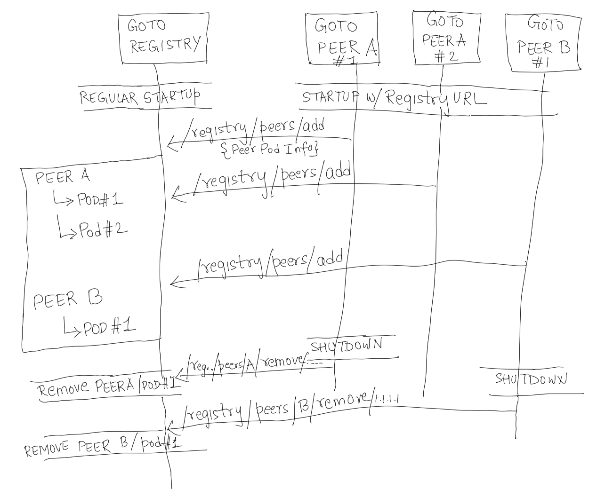
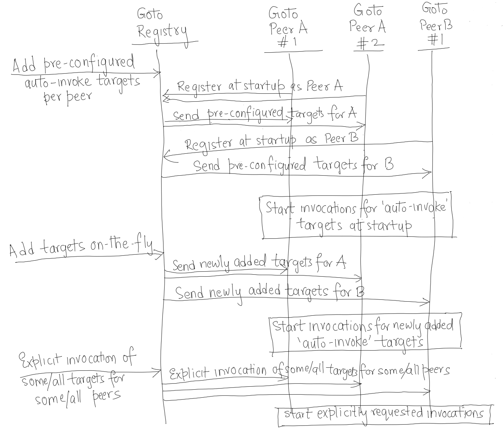
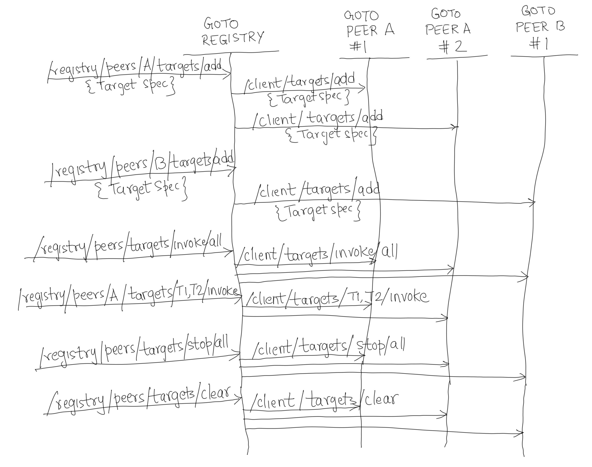

# Goto Registry - Peers Interactions

Peer instances register with the configured `Goto` registry at startup (`POST /registry/peers/add`, which returns the targets, jobs, tracking headers, time buckets and probe settings that the registry holds for the peer label), keep reminding the registry that they are alive (`POST /registry/peers/{peer}/remember`), and deregister at shutdown (`POST /registry/peers/{peer}/remove/{address}`). A pod that was loaded from a dump or cloned from another registry stays `offline` until it reminds the registry again. While running, peers report their client invocation results to the registry's current locker (see [Goto Lockers](goto-lockers.md)).

<br/>



<br/>
<br/>

All target management and traffic invocation operations for multiple peer instances can be done via the registry. The registry saves the targets and jobs per peer label, pushes them to every pod of the peer (so that all instances of a peer get the same configuration), and replies with a map of peer to pod address to success flag (see [Peer Push Results](registry-api-json-schemas.md#peer-push-results-json-schema)). Pods that register later get the saved targets and jobs at registration.

<br/>



<br/>
<br/>

Some examples of registry APIs used for peers targets management and traffic invocation:

```
curl -X POST localhost:8080/registry/peers/peer1/targets/add --data '{"name":"t1","url":"http://svc/foo","requestCount":10}'
curl -X POST localhost:8080/registry/peers/peer1/targets/t1/invoke
curl localhost:8080/registry/peers/peer1/client/results
```

<br/>



<br/>
<br/>

See [Registry Peers APIs](../pkg/registry/README.md#registry-peer-mgmt-apis)